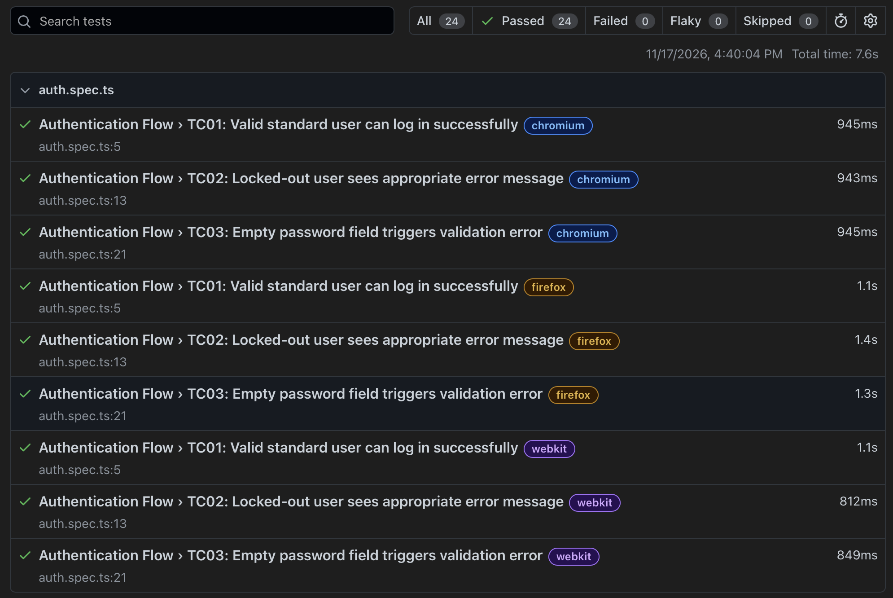

# E-Commerce End-to-End Test Automation Suite (Playwright + TypeScript)

An automated end-to-end (E2E) test suite built with **Playwright** and **TypeScript** using the **Page Object Model (POM)** design pattern. The suite validates critical user journeys—authentication, catalog sorting, shopping cart state management, and checkout flows—across **Chromium, Firefox, and WebKit**.



## Tech Stack
- **Test Framework:** Playwright Test
- **Language:** TypeScript
- **Design Pattern:** Page Object Model (POM)
- **CI/CD:** GitHub Actions (automated cross-browser regression on push/PR)
- **Reporting & Debugging:** Playwright HTML Reporter, failure screenshots, and execution traces

## Project Structure
```text
├── .github/workflows/       # GitHub Actions CI pipeline
├── docs/                    # Test execution report screenshots
├── pages/                   # Page Object Models (locators & reusable actions)
│   ├── LoginPage.ts
│   ├── InventoryPage.ts
│   ├── CartPage.ts
│   └── CheckoutPage.ts
├── tests/                   # E2E test specifications
│   ├── auth.spec.ts         # Login validation & negative error handling (TC01–TC03)
│   ├── cart.spec.ts         # Cart badge state, removal & price sorting (TC04–TC06)
│   └── checkout.spec.ts     # End-to-end checkout & required field checks (TC07–TC08)
└── playwright.config.ts     # Browser matrix, retries & artifact settings